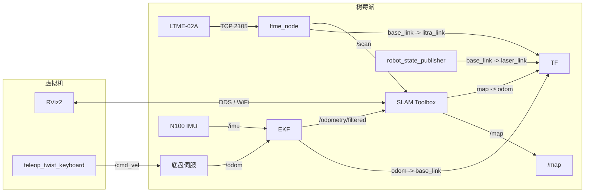
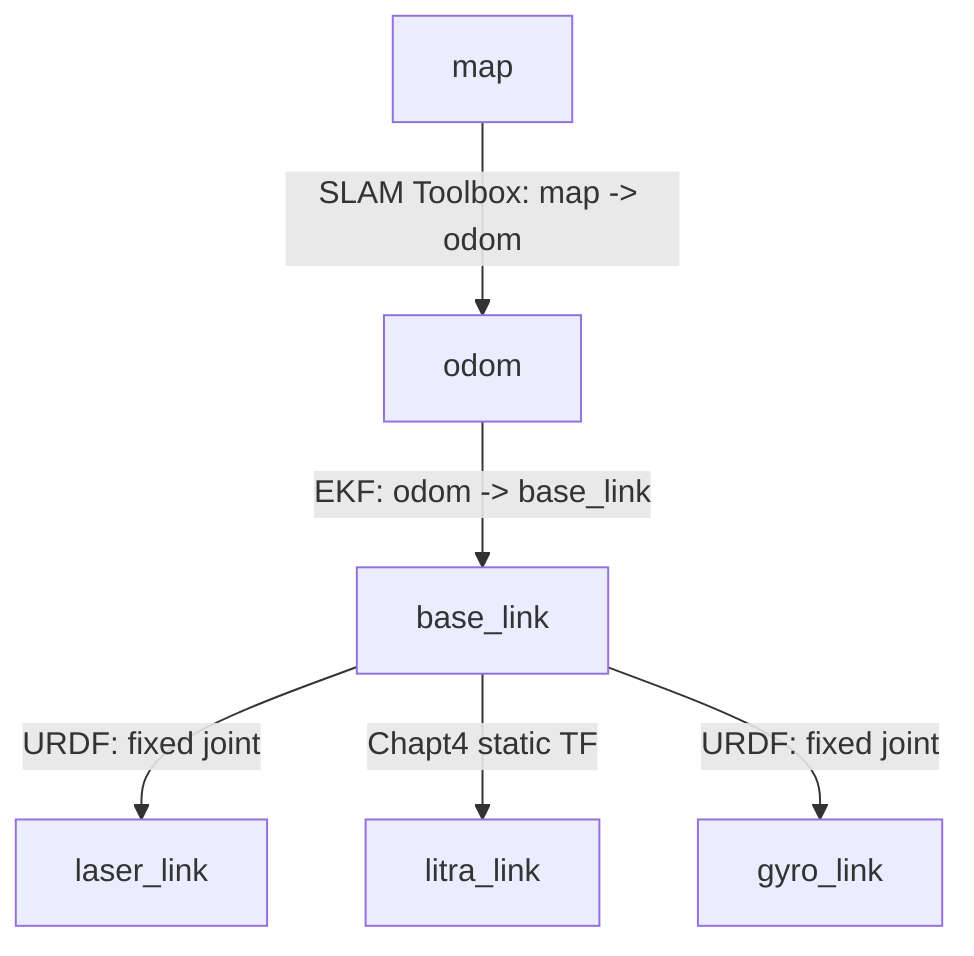
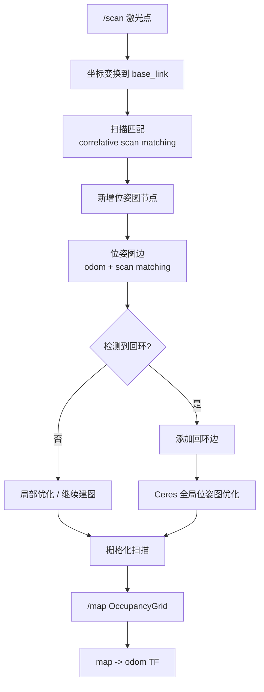
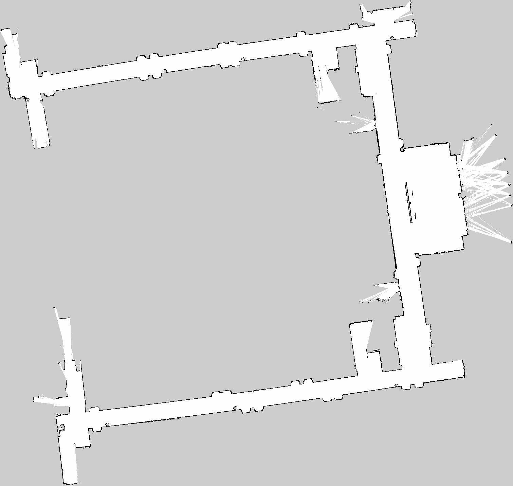
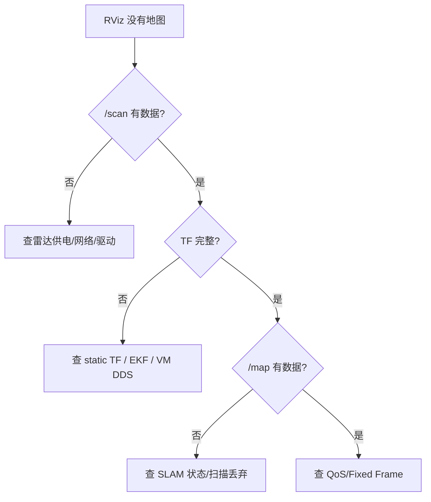

# Chapt4：Litra LTME-02A 接入与 SLAM Toolbox 建图


> 第四阶段：在 Chapt3 的底盘、IMU、EKF 和 URDF 基础上，接入 **Litra LTME-02A** 网口激光雷达，使用 **SLAM Toolbox** 构建二维栅格地图，并通过 `map_saver_cli` 保存 `.yaml` + `.pgm`。
>
> 本文既可以作为学习指南，也可以作为复现实操手册：想快速跑起来看[快速开始](#0-快速开始)；想理解原理看[SLAM 算法](#4-从激光到地图slam-toolbox-算法)；遇到问题看[故障排查](#9-故障排查)。

---

## 目录

- [0. 快速开始](#0-快速开始)
- [1. 阶段目标](#1-阶段目标)
- [2. 系统总览](#2-系统总览)
- [3. 传感器接入：LTME-02A](#3-传感器接入ltme-02a)
- [4. 从激光到地图：SLAM Toolbox 算法](#4-从激光到地图slam-toolbox-算法)
- [5. SLAM 参数与调优](#5-slam-参数与调优)
- [6. 建图实操](#6-建图实操)
- [7. 地图保存与文件格式](#7-地图保存与文件格式)
- [8. 验证记录与当前结果](#8-验证记录与当前结果)
- [9. 故障排查](#9-故障排查)
- [10. 设计取舍与局限](#10-设计取舍与局限)
- [11. 后续工作](#11-后续工作)
- [12. 参考与资料](#12-参考与资料)
- [附录 A：话题、TF、脚本速查](#附录-a话题tf脚本速查)
- [附录 B：参数速查](#附录-b参数速查)
- [附录 C：术语表](#附录-c术语表)
- [变更记录](#变更记录)

---

## 0. 快速开始

### 0.1 当前网络拓扑

```text
WiFi 192.168.8.0/24
  树莓派 wlan0 : 192.168.8.144
  虚拟机       : 192.168.8.x（必须是桥接模式）

以太网 192.168.10.0/24（只给雷达）
  树莓派 eth0  : 192.168.10.100/24
  LTME-02A     : 192.168.10.160
  TCP 端口     : 2105
```

> 树莓派 IP 会随网络变化，先执行 `hostname -I` 确认。VM 的 IP 用 `hostname -I` 查询，必须和树莓派在同一个 `192.168.8.x` 网段。

### 0.2 树莓派

```bash
# 1. 雷达网络（每次重启后可执行；当前 Pi 已用 netplan 持久化）
~/chapt4/setup_litra_network.sh eth0

# 2. 启动底盘 + IMU + URDF + LTME-02A + SLAM
~/chapt4/start_mapping.sh
```

启动后前 2~3 秒保持小车静止，等待 IMU 零偏校准；4~6 秒后 SLAM 激活。

### 0.3 虚拟机

第一次或 `vm_tools` 更新后：

```bash
mkdir -p ~/chapt4_vm

scp orangen@192.168.8.144:/home/orangen/chapt4/vm_tools/* ~/chapt4_vm/

chmod +x ~/chapt4_vm/*.sh
```

两个终端：

```bash
# 终端 1：RViz2
export ROS_STATIC_PEERS=192.168.8.144
~/chapt4_vm/start_rviz.sh
```

```bash
# 终端 2：键盘遥控，发布 /cmd_vel
export ROS_STATIC_PEERS=192.168.8.144
~/chapt4_vm/start_teleop.sh
```

### 0.4 保存地图

建图终端不要关闭，在树莓派另开终端：

```bash
~/chapt4/save_map.sh room
```

输出：

```text
~/chapt4/maps/room.yaml
~/chapt4/maps/room.pgm
```

### 0.5 最短验收

```bash
ros2 topic hz /scan                 # 约 15Hz
ros2 topic echo /scan --once --field header
ros2 topic echo /map --once --field info
ros2 run tf2_ros tf2_echo map base_link
```

---

## 1. 阶段目标

### 1.1 从 Chapt3 到哪里

Chapt3 已经让小车具备：

- 底盘 RS485 驱动；
- 轮式里程计 `/odom`；
- N100 IMU `/imu`；
- EKF `/odometry/filtered` 和 `odom -> base_link`；
- URDF 与 `base_link -> laser_link`；
- RPLIDAR A1 的 `/scan`。

但这些都还是**局部**信息：机器人知道自己相对起点走了多远，却不知道自己在房间的哪个位置，也没有一张可供导航使用的地图。

Chapt4 要补上的正是这一层：

```text
局部里程计 + 激光扫描  →  全局地图 + 全局位姿
```

### 1.2 本章要解决的问题

| 问题 | 本章方案 |
|---|---|
| 新雷达怎么接入 ROS 2 | LitraTech 官方 `ltme_node` + `ltme_interfaces` |
| 雷达数据如何变成 `/scan` | `LTME-02A` → TCP 2105 → `sensor_msgs/LaserScan` |
| 如何把扫描拼成地图 | SLAM Toolbox 图优化 2D SLAM |
| 如何避免与 EKF 抢 TF | SLAM 只发布 `map -> odom`，EKF 保留 `odom -> base_link` |
| 如何验证地图质量 | RViz 俯视、`/map`、`tf2_echo`、`map_saver_cli` |
| 如何保存地图 | `nav2_map_server/map_saver_cli` 输出 `.yaml` + `.pgm` |

### 1.3 验收标准

- `LTME-02A` 的 `/scan` 频率约 10~30Hz，实测约 15Hz；
- `frame_id=litra_link`，且 `base_link -> litra_link` TF 可查询；
- SLAM Toolbox 完成 `configure` / `activate`；
- `/map` 正常发布，`map -> base_link` 可查询；
- `map_saver_cli` 能生成 `.yaml` + `.pgm`；
- Chapt3 目录不被修改；
- 能通过 teleop 遥控走完一圈并观察地图闭合。

### 1.4 不在本章范围

- Nav2 路径规划、代价地图、AMCL；
- 多楼层/3D SLAM；
- 动态障碍物跟踪；
- 长期定位与地图版本管理；
- 自动回充、行为树。

这些属于后续阶段。

### 1.5 本章完成的主要工作

1. **雷达接入**：把 RPLIDAR A1 替换为 Litra LTME-02A，配置 `eth0` 网段、12V 供电和 mDNS 识别；
2. **驱动集成**：vendored LitraTech 官方 ROS 2 驱动 `ltme_node` / `ltme_interfaces`，发布 `/scan`；
3. **坐标系隔离**：新增 `base_link -> litra_link` 静态 TF，不修改 Chapt3 URDF；
4. **SLAM 配置**：接入 `async_slam_toolbox_node`，配置 `mode: mapping`、Ceres、回环、栅格分辨率；
5. **建图 bringup**：新增 `mapping.launch.py`，支持 `lidar_type:=litra/rplidar` 切换；
6. **可视化与遥控**：提供虚拟机 RViz 配置、teleop 脚本和 DDS 静态对端方案；
7. **地图保存**：封装 `map_saver_cli`，输出 `.yaml` + `.pgm`；
8. **工程化排错**：记录网络、VMnet0、IMU、静态 TF、DDS 组播、单 TCP 客户端等问题；
9. **文档**：把原理、参数、流程、实验结果和故障排查整理成可复现的 README。

---

## 2. 系统总览

### 2.1 硬件清单

| 组件 | 型号 | 接口 | 说明 |
|---|---|---|---|
| 主控 | Raspberry Pi 4B | — | Ubuntu 24.04 + ROS 2 Jazzy |
| 激光雷达 | **Litra LTME-02A** | RJ45 + 12V | 270° FOV，20m@70%，10~30Hz |
| 底盘 | 森创 DS/RS 二合一伺服 | RS485 | `/dev/ds_chassis` |
| IMU | 轮趣 N100 | USB 转串口 | `/dev/wheeltec_FDI_IMU_GNSS`，100Hz |
| 上位机 | PC 虚拟机 | 桥接 WiFi | RViz2 + `teleop_twist_keyboard` |
| 回退雷达 | 思岚 RPLIDAR A1 | USB | `lidar_type:=rplidar` 时使用 |

### 2.2 软件栈

| 层 | 组件 | 作用 |
|---|---|---|
| OS | Ubuntu 24.04 | 树莓派系统 |
| ROS | ROS 2 Jazzy | 通信、TF、launch、lifecycle |
| 雷达驱动 | `ltme_node` v1.0.2 | Litra LDCP → `/scan` |
| 底盘驱动 | `ds_base_driver` | `/cmd_vel` → 伺服，发布 `/odom` |
| IMU | `fdilink_ahrs` | `/imu`，启动零偏校准 |
| 状态估计 | `robot_localization` EKF | `/odom` + `/imu` → `/odometry/filtered` + TF |
| SLAM | **SLAM Toolbox 2.8.5** | 图优化 2D SLAM，发布 `/map` 和 `map -> odom` |
| 地图保存 | `nav2_map_server` 1.3.13 | `map_saver_cli` → `.yaml` / `.pgm` |
| 可视化 | RViz2 | 地图、扫描、TF、机器人模型 |

### 2.3 数据流



### 2.4 TF 树



关键约定：

- `map -> odom` 只由 SLAM Toolbox 发布；
- `odom -> base_link` 只由 EKF 发布；
- `base_link -> litra_link` 由 Chapt4 的静态 TF 发布；
- `base_link -> laser_link` 由 Chapt3 URDF 发布，仅在 RPLIDAR 回退时使用。

> 不要让 SLAM 和 EKF 同时发布 `odom -> base_link`。两套 TF 会互相覆盖，表现为机器人抖动、地图跳变。

### 2.5 核心话题

| 话题 | 类型 | 发布者 | 说明 |
|---|---|---|---|
| `/scan` | `sensor_msgs/LaserScan` | `ltme_node` | `frame_id=litra_link` |
| `/odom` | `nav_msgs/Odometry` | `ds_base_driver` | 轮式里程计，约 20Hz |
| `/imu` | `sensor_msgs/Imu` | `fdilink_ahrs` | N100，约 100Hz |
| `/odometry/filtered` | `nav_msgs/Odometry` | EKF | 约 30Hz |
| `/cmd_vel` | `geometry_msgs/Twist` | teleop | 断流 0.5s 刹停 |
| `/map` | `nav_msgs/OccupancyGrid` | SLAM Toolbox | Transient Local |
| `/map_updates` | `map_msgs/OccupancyGridUpdate` | SLAM Toolbox | 地图增量 |
| `/tf` | `tf2_msgs/TFMessage` | EKF / SLAM / URDF | 动态 TF |
| `/tf_static` | `tf2_msgs/TFMessage` | robot_state_publisher / static TF | 静态 TF |

### 2.6 目录结构

```text
chapt4/
├── README.md
├── AGENTS.md
├── start_mapping.sh                 # 树莓派一键建图
├── setup_litra_network.sh           # eth0 配 192.168.10.x 并 ping 雷达
├── save_map.sh                      # 保存 /map 为 yaml + pgm
├── teleop.sh                        # 树莓派本机键盘遥控
├── maps/
│   ├── room.yaml                    # 实测地图元数据
│   ├── room.pgm                     # 实测地图栅格
│   └── room.png                     # README 展示用预览
├── vm_tools/
│   ├── chapt4.rviz                  # RViz2：Fixed Frame=map
│   ├── fastdds_no_shm.xml           # 禁用共享内存，UDP-only
│   ├── start_rviz.sh
│   └── start_teleop.sh
└── chapt4_ws/
    └── src/
        ├── chapt4_slam/
        │   ├── config/slam_toolbox_mapping.yaml
        │   ├── launch/slam.launch.py
        │   └── rviz/mapping.rviz
        ├── chapt4_bringup/
        │   ├── config/ltme_02a.yaml
        │   ├── launch/mapping.launch.py
        │   ├── launch/lidar_litra.launch.py
        │   └── scripts/save_map.sh
        └── vendor/
            ├── ltme_interfaces/     # LitraTech 官方 ROS 2 接口
            └── ltme_node/           # LitraTech 官方 ROS 2 驱动
```

---

## 3. 传感器接入：LTME-02A

### 3.1 型号确认

设备外观为黑色方形底座、圆柱扫描头、正面 Litra 标志，配套手册为 LTME-02 系列。通过 mDNS 可以进一步确认：

```bash
avahi-browse -rt _ldcp._tcp
```

实测输出：

```text
+ eth0 IPv4 LTME-02_0197 _ldcp._tcp local
  hostname = [LTME-02_0197.local]
  address  = [192.168.10.160]
  port     = [2105]
  txt      = ["serial=21200197" "model=LTME-02A"]
```

因此默认型号固定为：

```yaml
device_model: LTME-02A
device_address: 192.168.10.160
```

### 3.2 关键规格

| 项目 | 值 |
|---|---|
| 测距原理 | 脉冲 ToF |
| 水平视场角 | 270°（正前方左右各 135°，后方 90° 盲区） |
| 最大探测距离 | ≥20m @70% 反射率；≥10m @10% |
| 扫描频率 | 10 / 15 / 20 / 30Hz |
| 角度分辨率 | 0.12° / 0.18° / 0.23° / 0.35° |
| 通信 | RJ45（另有 Molex 接口版本） |
| 默认 IP | `192.168.10.160` |
| 子网掩码 | `255.255.255.0` |
| TCP 端口 | `2105` |
| 供电 | DC 12V / 1A，5.5mm/2.1mm |
| PoE | **不支持** |

实测 `/scan`：

```text
平均频率：约 15.05Hz
angle_min：-2.356194 rad（-135°）
angle_max：+2.356194 rad（+135°）
beam 数：1537
range_min：0.05m
range_max：20.0m
```

### 3.3 为什么选择 LTME-02A

| 对比项 | RPLIDAR A1 | LTME-02A |
|---|---|---|
| 视场角 | 360° | 270°（后方 90° 盲区） |
| 标称量程 | 12m | 20m @70% |
| 接口 | USB 串口 | RJ45 以太网 |
| 扫描频率 | 约 5.5~10Hz | 10~30Hz |
| 供电 | 5V | 12V / 1A |
| 优点 | 360°、接线简单 | 量程更远、频率更高、网口抗干扰 |
| 代价 | 量程短、USB 易受干扰 | 需要 12V、需要配置网段、后方盲区 |

本项目需要较长的室内走廊和更高扫描频率，因此选择 LTME-02A；同时保留 `lidar_type:=rplidar` 作为回退。

> 270° 视场不是“缺点”，但会影响建图策略：后方 90° 没有数据，原地快速旋转或倒车时更容易丢失匹配。建图时应尽量让 270° 开口覆盖前进方向，并通过走环、回访起点完成回环。

### 3.4 接线与供电

```text
LTME-02A RJ45  →  树莓派 eth0
LTME-02A 电源  →  DC 12V / 1A
```

注意事项：

- **不要接 5V USB**；
- **不要接 PoE**，手册明确说明 LTME-02A 不支持 PoE，可能损坏以太网接口；
- 雷达 0° 方向应朝车头，270° 扫描开口朝前；
- 如果倒装或旋转安装，使用 `invert_frame` 或 `litra_roll/yaw` 修正；
- 雷达光学中心与 `base_link` 的偏移必须尽量准确，否则旋转时地图会被“拧歪”。

### 3.5 网络配置

#### 3.5.1 当前网络

```text
WiFi 192.168.8.0/24
  树莓派 wlan0 : 192.168.8.144
  虚拟机       : 192.168.8.x

以太网 192.168.10.0/24
  树莓派 eth0  : 192.168.10.100
  LTME-02A     : 192.168.10.160
```

WiFi 继续承担树莓派与虚拟机的 ROS 2 通信；`eth0` 只用于雷达，不能设置默认网关，否则会抢走 WiFi 的默认路由。

#### 3.5.2 一键配置脚本

```bash
~/chapt4/setup_litra_network.sh eth0
```

脚本会：

1. 启动 `eth0`；
2. 如果没有 `192.168.10.x` 地址，添加 `192.168.10.100/24`；
3. `ping 192.168.10.160` 验证雷达在线。

实测输出：

```text
Adding 192.168.10.100/24 to eth0
64 bytes from 192.168.10.160: icmp_seq=1 ttl=255 time=0.219 ms
Litra is reachable at 192.168.10.160
```

#### 3.5.3 持久化配置

NetworkManager 可能会清掉手工 `ip addr add` 的地址，因此当前树莓派使用 netplan 持久化：

```yaml
# /etc/netplan/99-litra-eth0.yaml
network:
  version: 2
  renderer: NetworkManager
  ethernets:
    eth0:
      optional: true
      dhcp4: false
      dhcp6: false
      accept-ra: false
      addresses:
        - 192.168.10.100/24
```

应用：

```bash
sudo chmod 600 /etc/netplan/99-litra-eth0.yaml
sudo netplan apply
ip -4 addr show eth0
ip route
```

确认：

```text
192.168.10.0/24 dev eth0 src 192.168.10.100
default via 192.168.8.1 dev wlan0
```

如果雷达 IP 被改过，可以用随附的 **LVS2D** 软件自动发现并修改；修改后需要重启雷达。

### 3.6 ROS 2 驱动

LitraTech 官方 ROS 2 驱动已经 vendored 到：

```text
chapt4_ws/src/vendor/ltme_interfaces
chapt4_ws/src/vendor/ltme_node
```

版本：

```text
LitraTech ROS2 v1.0.2-20240921
```

驱动内部使用 LDCP SDK：

```text
TCP 2105 → 扫描数据块 → beam 索引 → sensor_msgs/LaserScan
```

支持型号：

```text
LTME-02A / LT-R1 / LT-R2 / LT-I1 / LT-I2
```

默认参数文件：

```text
chapt4_ws/src/chapt4_bringup/config/ltme_02a.yaml
```

```yaml
ltme_node:
  ros__parameters:
    device_model: LTME-02A
    device_address: 192.168.10.160
    frame_id: litra_link
    invert_frame: false
    range_min: 0.05
    range_max: 20.0
    shadow_filter_strength: 15
```

### 3.7 `litra_link` 静态 TF

Chapt3 的 `laser_link` 固定为 `(0.08, 0, 0.21)`，但新雷达的实际安装位置可能不同。为了**不修改 Chapt3 URDF**，Chapt4 新增：

```text
base_link -> litra_link
```

默认偏移与旧 `laser_link` 相同：

```text
x=0.08m, y=0.0m, z=0.21m
yaw=pitch=roll=0
```

启动参数可覆盖：

```bash
~/chapt4/start_mapping.sh \
  litra_x:=0.08 litra_y:=0.0 litra_z:=0.21 \
  litra_yaw:=0.0 litra_pitch:=0.0 litra_roll:=0.0
```

> 参数必须是数字，不能写 `...`。如果写成 `litra_x:=...`，`static_transform_publisher` 会因参数解析失败退出，随后 SLAM 会因为缺少 `base_link -> litra_link` 丢弃所有扫描。

### 3.8 单独测试雷达

终端 1：

```bash
source /opt/ros/jazzy/setup.bash
source ~/chapt4/chapt4_ws/install/setup.bash

ros2 launch chapt4_bringup lidar_litra.launch.py
```

正常日志：

```text
[ltme_node]: Device opened
```

终端 2：

```bash
source /opt/ros/jazzy/setup.bash
export ROS_DOMAIN_ID=66
export ROS_LOCALHOST_ONLY=0

ros2 topic info /scan -v
ros2 topic hz /scan
ros2 topic echo /scan --once --field header
ros2 run tf2_ros tf2_echo base_link litra_link
```

预期：

```text
Publisher count: 1
Node name: ltme_node
average rate: 约 15Hz
frame_id: litra_link
Translation: [0.080, 0.000, 0.210]
```

> LTME-02A 只允许一个 TCP 客户端。不要同时运行 `lidar_litra.launch.py` 和 `start_mapping.sh`；否则第二个驱动会一直打印 `Waiting for device...`，或者 `nc 192.168.10.160 2105` 显示 `Connection refused`。

---

## 4. 从激光到地图：SLAM Toolbox 算法

### 4.1 SLAM 问题定义

2D 激光 SLAM 的输入是：

```text
z_{1:t}  激光扫描序列
u_{1:t}  里程计 / IMU / 控制输入
```

输出是：

```text
x_{1:t}  机器人轨迹
m        环境地图
```

目标是估计后验：

$$
p(x_{1:t}, m \mid z_{1:t}, u_{1:t})
$$

工程上通常拆成两部分：

1. **前端**：扫描匹配，估计相邻帧之间的相对位姿；
2. **后端**：位姿图优化，消除累计误差并处理回环。

### 4.2 SLAM Toolbox 是什么

本项目使用：

```text
包：slam_toolbox 2.8.5
节点：async_slam_toolbox_node
模式：mode: mapping
```

SLAM Toolbox 是 ROS 2 官方维护的 2D SLAM 实现，算法源自 **OpenKarto**，属于**图优化式 SLAM**，不是 GMapping 的粒子滤波，也不是 Cartographer 的 submap 方案。

核心组成：

```text
激光扫描
  → 扫描匹配（Scan Matching）
  → 位姿图（Pose Graph）
  → 回环检测（Loop Closure）
  → Ceres 位姿图优化
  → 占据栅格地图（OccupancyGrid）
```

### 4.3 算法流水线



### 4.4 扫描匹配

扫描匹配回答一个问题：

> 已知上一时刻的位姿和当前激光点，机器人现在相对上一时刻移动了多少？

SLAM Toolbox 使用相关匹配（correlative scan matching）在局部搜索窗口内寻找最优位姿：

1. 用里程计预测当前位姿；
2. 在预测位姿附近搜索 `x / y / yaw`；
3. 把当前扫描投影到局部占据栅格；
4. 计算匹配响应（扫描点落在障碍物上的程度）；
5. 取响应最高的位姿，作为当前帧的估计。

相关参数：

```yaml
correlation_search_space_dimension: 0.5
correlation_search_space_resolution: 0.01
correlation_search_space_smear_deviation: 0.1
link_match_minimum_response_fine: 0.1
```

意义：

- 搜索窗口越大，能容忍的里程计误差越大，但计算量也越大；
- 分辨率越细，匹配越精确，但更耗 CPU；
- 响应阈值越高，越不容易接受错误匹配，但也可能拒绝有效匹配。

> 扫描匹配非常依赖里程计预测。如果轮式里程计打滑、IMU 未校准或 `odom -> base_link` 漂移，匹配窗口可能覆盖不到真实位姿，表现为地图越来越歪。

### 4.5 位姿图

位姿图把机器人轨迹表示成图：

- **节点**：关键帧位姿 \(x_i = (x, y, \theta)\)；
- **边**：两个位姿之间的相对约束 \(z_{ij}\)；
- **信息矩阵**：\(\Omega_{ij}\)，表示该约束的置信度。

边的来源：

| 边类型 | 来源 | 作用 |
|---|---|---|
| 里程计边 | `/odometry/filtered` / TF | 提供局部连续约束 |
| 扫描匹配边 | 当前帧与局部地图 | 提供激光观测约束 |
| 回环边 | 历史关键帧匹配 | 消除长期累计误差 |

优化目标可以写成：

$$
\min_{X} \sum_{(i,j)\in E}
\left\|
\log\left(T_{ij}^{-1} T_i^{-1} T_j\right)
\right\|^2_{\Omega_{ij}}
$$

直观理解：

```text
每个节点都希望满足相邻约束
回环边把“走了很久之后的位姿”拉回历史位置
Ceres 同时调整所有节点，让整体误差最小
```

### 4.6 回环检测

回环检测回答：

> 我是不是回到了以前来过的地方？

流程：

1. 根据当前位姿，在历史节点中搜索候选；
2. 对候选节点做扫描匹配；
3. 响应超过阈值，并且满足链长条件，则添加回环边；
4. 触发全局位姿图优化；
5. `map -> odom` 发生修正，地图整体闭合。

关键参数：

```yaml
do_loop_closing: true
loop_search_maximum_distance: 5.0
loop_match_minimum_chain_size: 10
loop_match_minimum_response_coarse: 0.35
loop_match_minimum_response_fine: 0.45
loop_search_space_dimension: 8.0
```

调参理解：

- `loop_search_maximum_distance` 太小，走远后回到起点也不会检测回环；
- 响应阈值太低，可能产生错误回环，把地图“拉花”；
- `loop_match_minimum_chain_size` 控制回环链长度，太小会增加误匹配风险。

### 4.7 Ceres 位姿图优化

SLAM Toolbox 的 `solver_plugin` 使用 Ceres：

```yaml
solver_plugin: solver_plugins::CeresSolver
ceres_linear_solver: SPARSE_NORMAL_CHOLESKY
ceres_preconditioner: SCHUR_JACOBI
ceres_trust_strategy: LEVENBERG_MARQUARDT
ceres_dogleg_type: TRADITIONAL_DOGLEG
ceres_loss_function: None
```

这些参数的含义：

| 参数 | 作用 |
|---|---|
| `CeresSolver` | 使用 Ceres 求解非线性最小二乘 |
| `SPARSE_NORMAL_CHOLESKY` | 稀疏正规方程，适合位姿图 |
| `SCHUR_JACOBI` | Schur 消元预条件，提升求解效率 |
| `LEVENBERG_MARQUARDT` | 信赖域策略，兼顾收敛与稳定性 |
| `TRADITIONAL_DOGLEG` | Dogleg 步长策略 |
| `None` | 不使用鲁棒核函数；异常边会直接影响结果 |

为什么用 Ceres：

- 位姿图是稀疏非线性最小二乘问题；
- Ceres 对稀疏问题成熟、稳定；
- 支持多种线性求解器和信赖域策略；
- 在树莓派上可以处理中等规模室内地图。

如果场景中存在较多错误匹配，可以考虑使用 Huber 核函数抑制离群边；本项目当前保持 `None`，优先保证正常数据下的精度。

### 4.8 占据栅格地图

SLAM 的另一个输出是 `/map`，类型为 `nav_msgs/OccupancyGrid`。

每个栅格维护一个占据概率，工程上常用对数几率：

$$
l_t = l_{t-1} + \log\frac{p_{occ}}{1-p_{occ}} - l_0
$$

- 激光射线经过的格子：倾向“空闲”；
- 激光端点命中的格子：倾向“占据”；
- 没有观测到的格子：保持“未知”。

最终三值化：

```text
0    = 占据（occupied）
254  = 空闲（free）
205  = 未知（unknown）
```

参数：

```yaml
resolution: 0.05
```

表示每个像素 5cm。分辨率越小，地图越细，但内存和计算量越大。

`/map` 是 **Transient Local** 话题：新加入的 RViz 或 `map_saver_cli` 也能拿到最后一帧地图。因此：

```bash
ros2 topic hz /map
```

在没有地图更新时可能没有输出，这是正常的；应使用：

```bash
ros2 topic echo /map --once --field info
```

### 4.9 `map -> odom` 与 `odom -> base_link`

这是整套系统最重要的 TF 分工：

```text
map -> odom    SLAM Toolbox 发布
odom -> base_link  EKF 发布
```

为什么要分成两段？

- `odom` 是连续、平滑、但会累计漂移的局部坐标系；
- `map` 是全局、可能因回环发生跳变的坐标系；
- SLAM 把修正量放在 `map -> odom`，这样 `odom -> base_link` 仍然平滑，控制器不会因为回环跳变而抖动。

数学关系：

$$
T_{map,base} = T_{map,odom} \cdot T_{odom,base}
$$

因此：

$$
T_{map,odom} = T_{map,base} \cdot T_{odom,base}^{-1}
$$

当回环优化改变 \(T_{map,base}\) 时，SLAM 更新 \(T_{map,odom}\)，而 EKF 的 \(T_{odom,base}\) 不受影响。

### 4.10 异步模式与生命周期

`async_slam_toolbox_node` 的特点：

- 激光回调只负责把扫描放入队列；
- 独立线程做扫描匹配和建图；
- 通过 `minimum_time_interval` 控制处理频率；
- 避免高频率激光阻塞 ROS 回调。

对比：

| 模式 | 优点 | 缺点 |
|---|---|---|
| `async_slam_toolbox_node` | 不阻塞回调，适合高频雷达 | 需要队列和线程，参数更多 |
| `sync_slam_toolbox_node` | 处理确定、延迟低 | 高频时可能丢帧或阻塞 |

本项目使用异步模式，配合：

```yaml
minimum_time_interval: 0.10
map_update_interval: 2.0
transform_publish_period: 0.05
```

含义：

- 约 10Hz 处理扫描（传感器 15Hz）；
- 每 2 秒发布一次地图更新；
- 每 50ms 发布一次 TF。

### 4.11 为什么选 SLAM Toolbox，而不是 Cartographer

| 方案 | 原理 | 优点 | 缺点 | 本项目 |
|---|---|---|---|---|
| **SLAM Toolbox** | 图优化 + 扫描匹配 + Ceres | ROS 2 官方、apt 可装、异步、支持序列化 | 2D、参数较多 | ✅ 选用 |
| Cartographer | submap + 局部/全局优化 + Ceres | 建图质量好、回环强 | Jazzy 无官方二进制，源码编译重 | 未选 |
| GMapping | 粒子滤波 | 经典、2D 成熟 | 无显式回环、ROS 2 支持弱 | 未选 |
| Hector SLAM | 扫描匹配 | 不依赖里程计 | 特征少时容易漂 | 未选 |

选择理由：

1. 树莓派 4B + ROS 2 Jazzy，优先使用官方二进制；
2. SLAM Toolbox 直接提供 `map -> odom`，与 Chapt3 的 EKF 分工清晰；
3. 支持 `.posegraph` 序列化，方便后续定位模式；
4. 参数和 RViz 工具链完整，适合课程项目复现。

Cartographer 的坐标系参数对应关系：

| Cartographer | SLAM Toolbox | 本项目值 |
|---|---|---|
| `tracking_frame` | `base_frame` | `base_link` |
| `published_frame` | `odom_frame` | `odom` |
| `map_frame` | `map_frame` | `map` |
| `scan_topic` | `scan_topic` | `/scan` |
| `provide_odom_frame` | 不需要（EKF 提供） | — |

### 4.12 SLAM 不是“万能纠偏”

SLAM 能修正累计误差，但前提是：

- 扫描匹配能找到足够好的对应；
- 里程计预测不会偏差到搜索窗口之外；
- 雷达外参（位置、朝向）准确；
- 环境有足够的几何特征；
- 回环检测能触发。

因此，**IMU、轮式里程计、雷达安装位置**任何一个出问题，都会表现为“地图越来越歪”。这不是 SLAM 算法本身能完全弥补的。

---

## 5. SLAM 参数与调优

### 5.1 参数文件

```text
chapt4_ws/src/chapt4_slam/config/slam_toolbox_mapping.yaml
```

### 5.2 关键参数

| 参数 | 当前值 | 作用 |
|---|---|---|
| `odom_frame` | `odom` | 局部里程计坐标系 |
| `map_frame` | `map` | 全局地图坐标系 |
| `base_frame` | `base_link` | 机器人基座 |
| `scan_topic` | `/scan` | 激光话题 |
| `mode` | `mapping` | 建图模式 |
| `resolution` | `0.05` | 5cm/格 |
| `min_laser_range` | `0.15` | 过滤过近点 |
| `max_laser_range` | `20.0` | 过滤超量程点 |
| `minimum_time_interval` | `0.10` | 约 10Hz 处理 |
| `minimum_travel_distance` | `0.10` | 每 10cm 新增节点 |
| `minimum_travel_heading` | `0.10` | 每约 5.7° 新增节点 |
| `map_update_interval` | `2.0` | 地图发布周期 |
| `transform_publish_period` | `0.05` | TF 发布周期 |
| `use_scan_matching` | `true` | 启用扫描匹配 |
| `use_scan_barycenter` | `true` | 使用扫描重心提高稳定性 |
| `do_loop_closing` | `true` | 启用回环 |
| `loop_search_maximum_distance` | `5.0` | 回环候选搜索半径 |
| `scan_buffer_size` | `10` | 扫描缓存 |
| `scan_buffer_maximum_scan_distance` | `20.0` | 扫描缓存距离 |
| `solver_plugin` | `CeresSolver` | 位姿图求解器 |

### 5.3 调参思路

#### 地图细节不够

- 减小 `resolution`（例如 0.03），但内存和 CPU 会增加；
- 降低 `minimum_travel_distance`，增加节点密度；
- 确保 `max_laser_range` 覆盖有效墙面。

#### 树莓派 CPU 吃紧

- 增大 `minimum_time_interval`（例如 0.15）；
- 降低 `max_laser_range`；
- 增大 `minimum_travel_distance`；
- 减少 RViz 在本机运行。

#### 长走廊容易漂

- 增大 `max_laser_range`，利用远处墙面；
- 增大 `loop_search_maximum_distance`；
- 降低速度，避免轮式里程计打滑；
- 检查雷达外参和 IMU 零偏。

#### 回环不触发

- 增大 `loop_search_maximum_distance`；
- 确认回到了历史区域；
- 检查 `loop_match_minimum_response_*` 是否过高；
- 检查地图尺寸是否远超预期（可能已经漂移）。

#### 回环错误、地图拉花

- 提高 `loop_match_minimum_response_coarse/fine`；
- 增大 `loop_match_minimum_chain_size`；
- 降低速度，避免扫描畸变；
- 检查雷达时间戳和 TF 时间是否一致。

### 5.4 当前参数的设计理由

```yaml
max_laser_range: 20.0
```

LTME-02A 标称 20m@70%，旧 RPLIDAR 的 12m 截断不再适用。实测驱动可能返回超过 20m 的离群点，SLAM 会按 `max_laser_range` 过滤。

```yaml
minimum_time_interval: 0.10
```

传感器约 15Hz，完全处理约 15Hz 对树莓派压力较大；10Hz 处理在精度和负载之间比较平衡。

```yaml
minimum_travel_distance: 0.10
minimum_travel_heading: 0.10
```

更密的节点有利于回环和局部匹配，但会增加图优化规模；10cm / 5.7° 适合室内低速建图。

```yaml
loop_search_maximum_distance: 5.0
```

当前地图可能达到数十米，3m 的回环搜索半径偏小；5m 更适合房间/走廊回访。

---

## 6. 建图实操

### 6.1 前置检查

```bash
# 设备别名
ls -l /dev/ds_chassis /dev/wheeltec_FDI_IMU_GNSS

# 雷达网络
ip -4 addr show eth0
ping -c 3 192.168.10.160

# 当前 IP
hostname -I
```

预期：

```text
/dev/ds_chassis -> ttyUSB0
/dev/wheeltec_FDI_IMU_GNSS -> ttyUSB1
inet 192.168.10.100/24
192.168.10.160 ping 通
192.168.8.144
```

> IMU 必须插在原来的 USB 口（udev 规则按端口绑定）。如果 `/dev/wheeltec_FDI_IMU_GNSS` 不存在，EKF 只剩轮式角速度，地图会明显漂移。

### 6.2 树莓派启动

```bash
~/chapt4/start_mapping.sh
```

启动内容：

```text
ds_base_driver
fdilink_ahrs
robot_state_publisher
joint_state_publisher
ltme_node
litra_static_tf
ekf_filter_node（延迟）
async_slam_toolbox_node（延迟）
```

启动后：

1. 前 2~3 秒保持静止，等待 `gyro z bias calibrated`；
2. 等 4~6 秒，SLAM 完成 configure/activate；
3. 再开始遥控。

### 6.3 树莓派验证

另开终端：

```bash
source /opt/ros/jazzy/setup.bash
export ROS_DOMAIN_ID=66
export ROS_LOCALHOST_ONLY=0
export ROS_AUTOMATIC_DISCOVERY_RANGE=SUBNET

ros2 node list | grep -E 'ltme|slam|ekf|ahrs'
ros2 topic hz /scan
ros2 topic echo /scan --once --field header
ros2 topic hz /imu
ros2 topic hz /odometry/filtered
ros2 topic echo /map --once --field info
ros2 run tf2_ros tf2_echo base_link litra_link
ros2 run tf2_ros tf2_echo map base_link
```

预期：

```text
/scan 约 15Hz
frame_id: litra_link
/imu 约 100Hz
/odometry/filtered 约 30Hz
/map 有 width/height
base_link -> litra_link 存在
map -> base_link 存在
```

### 6.4 虚拟机 RViz

如果虚拟机还没同步脚本：

```bash
mkdir -p ~/chapt4_vm
scp orangen@192.168.8.144:/home/orangen/chapt4/vm_tools/* ~/chapt4_vm/
chmod +x ~/chapt4_vm/*.sh
```

启动：

```bash
export ROS_STATIC_PEERS=192.168.8.144
~/chapt4_vm/start_rviz.sh
```

RViz 配置：

```text
Fixed Frame: map
Map: /map（Transient Local）
LaserScan: /scan
Odometry: /odometry/filtered
RobotModel: /robot_description
TF
```

建议把视图改成俯视：

```text
Views → Current View → Type: TopDownOrtho
Target Frame: map
```

### 6.5 虚拟机 teleop

```bash
export ROS_STATIC_PEERS=192.168.8.144
~/chapt4_vm/start_teleop.sh
```

按键：

| 按键 | 动作 |
|---|---|
| `i` / `,` | 前进 / 后退 |
| `j` / `l` | 左转 / 右转 |
| `u` / `o` / `m` / `.` | 斜向弧线 |
| `k` | 停止 |
| `q` / `z` | 整体加速 / 减速 |
| `w` / `x` | 只调线速度 |
| `e` / `c` | 只调角速度 |
| `Ctrl+C` | 退出 |

建议速度：

```text
线速度 0.1~0.2 m/s
角速度 0.3~0.5 rad/s
```

### 6.6 驾驶策略

1. 先直行几米，观察地图墙面是否连续；
2. 沿着房间边界慢走一圈；
3. 转弯用弧线，尽量不要原地高速旋转；
4. 回到起点附近再走一小段，触发回环；
5. 观察灰色未知区域逐渐减少；
6. 如果墙面出现双层/重影，先降速，再检查 IMU 和外参；
7. 不要频繁倒车，270° 后方盲区不利于匹配。

### 6.7 停止

```text
1. 虚拟机 teleop：Ctrl+C
2. 虚拟机 RViz：Ctrl+C
3. 树莓派 start_mapping.sh：Ctrl+C
```

底盘节点退出时会下零速、发失能帧并关闭串口。

---

## 7. 地图保存与文件格式

### 7.1 一键保存

建图终端不要关闭，在树莓派另开终端：

```bash
~/chapt4/save_map.sh room
```

输出：

```text
~/chapt4/maps/room.yaml
~/chapt4/maps/room.pgm
```

也可以指定路径：

```bash
~/chapt4/save_map.sh /tmp/my_maps/lab_room
```

### 7.2 内部命令

脚本调用：

```bash
ros2 run nav2_map_server map_saver_cli \
  -f ~/chapt4/maps/room \
  --fmt pgm \
  --mode trinary \
  --ros-args \
  -p use_sim_time:=false \
  -p map_subscribe_transient_local:=true
```

注意：

- `map_saver_cli` 只负责把 `/map` 保存成文件；
- 它不是 SLAM 算法；
- 保存时 SLAM 必须仍在运行；
- `/map` 是 Transient Local，新启动的 saver 也能拿到最后一帧。

### 7.3 YAML 字段

实测 `maps/room.yaml`：

```yaml
image: room.pgm
mode: trinary
resolution: 0.050
origin: [-10.454, -9.141, 0]
negate: 0
occupied_thresh: 0.65
free_thresh: 0.196
```

| 字段 | 含义 |
|---|---|
| `image` | PGM 文件名，和 YAML 同目录 |
| `mode` | `trinary` 三值地图 |
| `resolution` | 0.05m/像素 |
| `origin` | 地图左下角在 `map` 中的 `[x, y, yaw]` |
| `negate` | 是否反转黑白 |
| `occupied_thresh` | 占据阈值 |
| `free_thresh` | 空闲阈值 |

### 7.4 PGM 格式

PGM 是 Netpbm 灰度图：

```text
P5          魔数
1511 1431   宽 高
255         最大值
<binary>    像素数据
```

常见像素值：

```text
0    occupied
254  free
205  unknown
```

### 7.5 序列化位姿图

如果后续要做 SLAM Toolbox 定位模式或 Nav2，建议同时保存位姿图：

```bash
ros2 service call /slam_toolbox/serialize_map \
  slam_toolbox/srv/SerializePoseGraph \
  "{filename: '/home/orangen/chapt4/maps/room'}"
```

会生成：

```text
room.posegraph
room.data
```

`map_saver_cli` 只保存栅格图，不保存位姿图。

### 7.6 当前实测结果

当前保存的 `maps/room.pgm`：

```text
尺寸：1511 × 1431
分辨率：0.05m/格
覆盖范围：约 75.5m × 71.5m
```



> 这张图用于验证“SLAM → `/map` → `map_saver_cli`”链路。图中右侧存在明显白色射线伪影，为雷达透过玻璃门所导致。

---

## 8. 验证记录与当前结果

### 8.1 2026-11-16：RPLIDAR 回退链路

- `chapt4_slam`、`chapt4_bringup` 编译通过；
- `/scan` 约 6.9Hz；
- SLAM 日志 `Registering sensor: [Custom Described Lidar]`；
- `/map` 正常，冒烟测试 166×82；
- `map -> base_link` 可查询；
- `save_map.sh` 生成 `.yaml` + `.pgm`。

### 8.2 2026-11-18：Litra 驱动接入

- `ltme_interfaces`、`ltme_node` 编译通过；
- `lidar_litra.launch.py` 可启动驱动；
- `base_link -> litra_link` 静态 TF 正常；
- 未接雷达时日志 `Waiting for device... [192.168.10.160]`，驱动会重试。

### 8.3 2026-11-20：LTME-02A 实机

- mDNS 识别：`LTME-02_0197` / `model=LTME-02A`；
- `/scan` 约 15.05Hz；
- `frame_id=litra_link`；
- 参数 `LTME-02A`、`range_max=20.0`；
- `/map` 初始 46×116；
- 存在有效距离数据。

### 8.4 2026-11-21：完整建图尝试

- IMU 未插时 `/imu Publisher count: 0`，EKF 仅靠轮式角速度，地图漂移明显；
- 插回 N100 后 `/imu` 恢复约 100Hz；
- 错误地把 `litra_x:=...` 当作参数传入，导致 `static_transform_publisher` 退出，SLAM 报 `Message Filter ... queue is full`；
- 改为默认 `litra_x=0.08` 后，静态 TF 恢复；
- 当前地图仍有漂移/射线伪影，需要继续标定外参、保持 IMU 在线并重新建图。

### 8.5 验收清单

- [x] Chapt3 目录未修改
- [x] 4 个包编译通过
- [x] LTME-02A `/scan` 约 15Hz
- [x] `base_link -> litra_link` 静态 TF
- [x] SLAM Toolbox configure/activate
- [x] `/map` 发布
- [x] `map_saver_cli` 生成 `.yaml` + `.pgm`
- [x] `/imu` 恢复 100Hz
- [ ] 外参标定完成
- [ ] 无漂移的完整室内地图
- [ ] 虚拟机跨机 TF 稳定（受 WiFi 组播影响，脚本已提供静态对端方案）
- [ ] Nav2 导航（下一阶段）

---

## 9. 故障排查

### 9.1 排查顺序



### 9.2 常见问题表

| 现象 | 原因 | 处理 |
|---|---|---|
| `Waiting for device... [192.168.10.160]` | 雷达未上电、网线未通、IP 不对、端口被占用 | `ping 192.168.10.160`；`pgrep -af ltme_node`；只保留一个客户端 |
| `Connection refused` 访问 2105 | 已有 `ltme_node`/LVS2D 占用，或雷达未就绪 | 关闭多余客户端；必要时重启雷达 |
| `/scan Publisher count: 0` | 驱动未打开设备 | 查 `ltme_node` 日志；确认 `Device opened` |
| `/imu Publisher count: 0` | IMU 未插、USB 口不对、别名丢失 | `ls -l /dev/wheeltec_FDI_IMU_GNSS`；插回原 USB 口 |
| `Message Filter dropping ... queue is full` | `litra_link`/`odom`/`map` TF 缺失或时间不匹配 | 查 `static_transform_publisher` 是否存活；`tf2_echo` |
| `static_transform_publisher` 启动即退出 | `litra_x:=...` 等非法数字 | 使用默认值或真实数字 |
| `/map` 不出现 | SLAM 未激活、`/scan` 无数据、TF 不完整 | `ros2 node list`；`ros2 lifecycle get /slam_toolbox`；查日志 |
| RViz 有 `/scan` 但 `No tf data` | VM 网络/组播问题 | 桥接模式；`ROS_STATIC_PEERS=192.168.8.144` |
| VM `ens33 DOWN` / `no carrier` | VMnet0 未桥接到 WiFi | 虚拟网络编辑器建 VMnet0，桥接 WiFi |
| `Network is unreachable` | VM 不在 `192.168.8.x` | 修 VM 桥接；`hostname -I` |
| 地图重影/漂移 | IMU 缺失、外参错误、速度太快、轮式打滑 | 先修 IMU，再标定 `litra_x/y/z/yaw`，降速 |
| 回环不触发 | 搜索半径太小、未回到历史区域 | 增大 `loop_search_maximum_distance`；回访起点 |
| 回环把地图拉花 | 误匹配 | 提高回环响应阈值；降低速度；检查外参 |
| `/map` 没有 `hz` 输出 | Transient Local，不持续发布 | 用 `ros2 topic echo /map --once --field info` |
| `ROS_LOCALHOST_ONLY` 警告 | Jazzy 已弃用 | 保留兼容即可；优先使用 `ROS_AUTOMATIC_DISCOVERY_RANGE` |
| 脚本 `AMENT_TRACE_SETUP_FILES` 未定义 | ROS setup 脚本与 `set -u` 冲突 | 脚本使用 `set -eo pipefail`，不要加 `-u` |

### 9.3 关键诊断命令

```bash
# 节点与话题
ros2 node list
ros2 topic list | sort
ros2 topic info /scan -v
ros2 topic info /tf -v
ros2 topic hz /scan
ros2 topic hz /imu
ros2 topic hz /odometry/filtered
ros2 topic echo /map --once --field info

# TF
ros2 run tf2_ros tf2_echo base_link litra_link
ros2 run tf2_ros tf2_echo odom base_link
ros2 run tf2_ros tf2_echo map base_link
ros2 run tf2_ros tf2_monitor

# 静态 TF 进程
pgrep -af static_transform_publisher
pgrep -af ltme_node
pgrep -af ahrs_driver
```

### 9.4 日志中的关键行

```text
[ltme_node]: Device opened
[ahrs_driver_node]: gyro z bias calibrated
[async_slam_toolbox_node]: Registering sensor
[static_transform_publisher]: from 'base_link' to 'litra_link'
```

如果看到：

```text
static_transform_publisher-2: process has died
```

先检查 launch 参数，再检查 TF。

### 9.5 虚拟机网络与 DDS

如果虚拟机出现以下任一现象：

```text
ens33 DOWN
no carrier
Network is unreachable
RViz 有 /scan 但没有 /tf
```

按下面顺序检查。

#### VMware 网络

```text
虚拟机 → 设置 → 网络适配器
→ 已连接
→ 启动时连接
→ 桥接模式
```

如果“虚拟网络编辑器”里没有 `VMnet0`：

```text
编辑 → 虚拟网络编辑器
→ 更改设置（管理员）
→ 添加网络 → VMnet0
→ 桥接模式
→ 桥接到当前 WiFi 网卡
→ 应用 → 确定
```

常见错误是桥接到了：

```text
Realtek PCle GbE Family Controller
```

这是有线网卡，如果主机没有插网线，虚拟机就没有 carrier。应选择 WiFi 网卡。

修改后：

```text
虚拟机关机 → 再开机
```

不要只重启 Ubuntu。

在虚拟机确认：

```bash
sudo ip link set ens33 up
sudo dhclient -v ens33
sudo ethtool ens33 | grep -E 'Link detected|Speed'
ip -br addr show ens33
hostname -I
```

必须看到：

```text
Link detected: yes
ens33  UP  192.168.8.x/24
```

#### ROS 2 DDS

WiFi AP 可能屏蔽组播，导致虚拟机只发现部分发布者。虚拟机启动 RViz/teleop 前设置：

```bash
export ROS_DOMAIN_ID=66
export ROS_AUTOMATIC_DISCOVERY_RANGE=SUBNET
export ROS_STATIC_PEERS=192.168.8.144
```

如果树莓派也看不到部分节点，可以在树莓派启动时加上虚拟机 IP：

```bash
export ROS_STATIC_PEERS=<虚拟机IP>
~/chapt4/start_mapping.sh
```

验证：

```bash
ros2 daemon stop
ros2 node list
ros2 topic hz /tf
ros2 run tf2_ros tf2_echo map base_link
```

> NAT 模式可以 `scp`，但 ROS 2 跨机 DDS 通常无法正常工作；建图必须使用桥接模式。

### 9.6 IMU 与地图漂移

如果地图越走越歪，先检查 IMU：

```bash
ls -l /dev/wheeltec_FDI_IMU_GNSS
ros2 topic info /imu -v
ros2 topic hz /imu
```

正常：

```text
/dev/wheeltec_FDI_IMU_GNSS -> ttyUSB1
Publisher count: 1
average rate: 约 100Hz
```

异常：

```text
ls: cannot access '/dev/wheeltec_FDI_IMU_GNSS': No such file or directory
Publisher count: 0
```

说明 N100 没有接入，EKF 只剩轮式角速度。轮式里程计在打滑、急转、地毯上误差会累积，地图就会漂。

处理：

1. 把 IMU 插回原来的 USB 口（udev 按端口绑定）；
2. 确认别名出现；
3. 重启 `start_mapping.sh`；
4. 启动后前 2~3 秒保持静止；
5. 日志出现 `gyro z bias calibrated`；
6. 再开始遥控。

### 9.7 静态 TF 与扫描丢弃

如果看到：

```text
Message Filter dropping message: frame 'litra_link' ...
discarding message because the queue is full
```

通常不是雷达坏了，而是 `litra_link` 到 `base_link` 的 TF 不可用。

检查：

```bash
pgrep -af static_transform_publisher
ros2 run tf2_ros tf2_echo base_link litra_link
ros2 topic echo /scan --once --field header
```

正常：

```text
static_transform_publisher 进程存在
base_link -> litra_link Translation [0.080, 0.000, 0.210]
frame_id: litra_link
```

如果进程不存在，看 launch 日志：

```bash
latest=$(ls -td ~/.ros/log/*/ | head -1)
grep -i 'static_transform' "$latest/launch.log"
```

常见原因：

```text
litra_x:=...
```

`...` 不是数字，`static_transform_publisher` 会退出。使用默认值或真实数字：

```bash
~/chapt4/start_mapping.sh
# 或
~/chapt4/start_mapping.sh litra_x:=0.08 litra_y:=0.0 litra_z:=0.21
```

### 9.8 地图质量判断

RViz 使用 `TopDownOrtho` 俯视，检查：

- 墙面是否是单线，是否出现双层/重影；
- 地面空闲区域是否连续；
- 回环后起点附近是否闭合；
- 未知灰色区域是否只出现在未走到/雷达盲区；
- 是否出现从机器人向外辐射的白色射线伪影。

如果出现明显重影或射线：

1. 降低速度；
2. 检查 IMU 是否在线；
3. 标定 `litra_x/y/z/yaw/pitch/roll`；
4. 确认雷达 0° 朝车头；
5. 检查 `max_laser_range` 和回环参数；
6. 重新建图，不要在当前漂移地图上继续叠加。

---

## 10. 设计取舍与局限

### 10.1 为什么不用 Cartographer

- Cartographer 的建图质量很好，但 ROS 2 Jazzy 没有官方二进制包；
- 源码编译依赖 Ceres、Protobuf、Lua、Abseil 等，在树莓派上耗时且容易出错；
- 本项目重点是“完整链路 + 可复现”，SLAM Toolbox 更合适；
- Cartographer 的 `tracking_frame` / `published_frame` 已在本项目映射为 `base_frame` / `odom_frame`，便于后续迁移。

### 10.2 270° 视场的代价

- 后方 90° 没有数据；
- 原地旋转时，后方盲区容易导致匹配退化；
- 倒车和窄走廊掉头更困难；
- 需要通过“走环 + 回访”补全地图。

### 10.3 2D 地图的局限

- 假设地面平整；
- 不能表达楼梯、坡道、悬空障碍；
- 只能用于平面导航；
- 动态障碍不会进入长期地图。

### 10.4 轮式里程计 + IMU 的局限

- 轮式里程计在打滑、地毯、急转时误差大；
- IMU 零偏需要静止校准；
- EKF 只融合 `vx` 和 `vyaw`，不融合绝对位置；
- SLAM 的扫描匹配可以修正，但不能完全替代好的里程计。

### 10.5 当前地图的主要问题

- IMU 缺失时仅靠轮式角速度，长距离后航向漂移；
- 雷达外参未精确测量，旋转时地图可能“拧”；
- 速度偏快时扫描畸变；
- 270° 后方盲区导致部分区域未知；
- 回环参数对大地图偏保守。

---

## 11. 后续工作

### 11.1 外参标定

1. 测量 `base_link` 到雷达光学中心的 `x/y/z`；
2. 确认雷达 0° 朝车头；
3. 用 `litra_x/y/z/yaw/pitch/roll` 覆盖；
4. 原地慢转 360°，观察墙面是否稳定；
5. 若地图镜像，检查 `invert_frame` 或 `roll=π`。

### 11.2 重新建图

- 保持 IMU 在线；
- 启动后静止 2~3 秒；
- 低速走完整房间；
- 回到起点完成回环；
- 确认墙面单线、无明显重影后再保存；
- 同时保存 `.yaml/.pgm` 和 `.posegraph`。

### 11.3 Nav2

Chapt5 可以基于本章地图做：

- `map_server` 加载 `room.yaml`；
- AMCL 定位；
- 全局/局部代价地图；
- 路径规划与控制；
- 行为树与恢复行为。

### 11.4 定位模式

SLAM Toolbox 支持：

```yaml
mode: localization
map_file_name: /home/orangen/chapt4/maps/room
map_start_pose: [0.0, 0.0, 0.0]
```

需要 `.posegraph` 和 `.data` 文件。定位模式不再建图，只发布 `map -> odom`。

### 11.5 工程化

- systemd 常驻；
- 网络配置持久化；
- 参数外置 YAML；
- 日志分级；
- 地图版本管理；
- 远程监控。

---

## 12. 参考与资料

### 12.1 本地手册

```text
LTME-02A系列激光雷达产品规格书20230331（V1.2)(1).pdf
LTME-02系列激光雷达用户手册20220331（V1.2)(1).pdf
LTME-02系列激光雷达SDK使用指南-20201014(1).pdf
使用LVS2D软件修改雷达参数说明(1).pdf
```

> 手册版权归深圳力策科技有限公司所有，仅用于本项目硬件接入参考。

### 12.2 上游链接

- SLAM Toolbox: <https://github.com/SteveMacenski/slam_toolbox>
- LitraTech ROS 2 驱动: <https://github.com/LitraTech/ltme_node>
- LitraTech LDCP SDK: <https://github.com/LitraTech/ldcp_sdk>
- Nav2 map_server: <https://docs.nav2.org/>
- Ceres Solver: <http://ceres-solver.org/>
- ROS 2 TF2: <https://docs.ros.org/en/jazzy/Tutorials/Intermediate/Tf2/Tf2-Main.html>

### 12.3 第三方组件说明

- `ltme_node` / `ltme_interfaces` 来自 LitraTech 官方仓库，遵循其上游许可证；
- LDCP SDK 内置 Asio、RapidJSON 等第三方库，遵循各自许可证；
- 本项目仅保留驱动构建所需的最小子集。

---

## 附录 A：话题、TF、脚本速查

### A.1 TF

```text
map -> odom             SLAM Toolbox
odom -> base_link       EKF
base_link -> litra_link Chapt4 static TF
base_link -> laser_link Chapt3 URDF（RPLIDAR 回退）
base_link -> gyro_link  Chapt3 URDF
```

### A.2 设备别名

```text
/dev/ds_chassis                底盘 RS485
/dev/wheeltec_FDI_IMU_GNSS     N100 IMU
eth0                           LTME-02A 以太网
192.168.10.160                 LTME-02A 默认 IP
/dev/rplidar                   RPLIDAR A1（回退）
```

### A.3 脚本

| 脚本 | 位置 | 作用 |
|---|---|---|
| `start_mapping.sh` | 树莓派 `~/chapt4` | 一键启动建图 |
| `setup_litra_network.sh` | 树莓派 `~/chapt4` | 配置 eth0 并 ping 雷达 |
| `save_map.sh` | 树莓派 `~/chapt4` | 保存 `/map` 为 yaml/pgm |
| `teleop.sh` | 树莓派 `~/chapt4` | 树莓派本机遥控 |
| `start_rviz.sh` | 虚拟机 `~/chapt4_vm` | RViz2 |
| `start_teleop.sh` | 虚拟机 `~/chapt4_vm` | 键盘遥控 |

### A.4 环境变量

| 变量 | 值 | 说明 |
|---|---|---|
| `ROS_DOMAIN_ID` | `66` | 树莓派和虚拟机一致 |
| `ROS_LOCALHOST_ONLY` | `0` | 允许跨机 |
| `ROS_AUTOMATIC_DISCOVERY_RANGE` | `SUBNET` | 同网段发现 |
| `ROS_STATIC_PEERS` | `192.168.8.144` | WiFi 屏蔽组播时的静态对端 |
| `FASTRTPS_DEFAULT_PROFILES_FILE` | `fastdds_no_shm.xml` | 禁用共享内存 |
| `FASTDDS_BUILTIN_TRANSPORTS` | `UDPv4` | 只用 UDP |

---

## 附录 B：参数速查

```yaml
slam_toolbox:
  ros__parameters:
    odom_frame: odom
    map_frame: map
    base_frame: base_link
    scan_topic: /scan
    mode: mapping
    use_map_saver: true

    resolution: 0.05
    min_laser_range: 0.15
    max_laser_range: 20.0
    minimum_time_interval: 0.10
    minimum_travel_distance: 0.10
    minimum_travel_heading: 0.10
    map_update_interval: 2.0
    transform_publish_period: 0.05
    tf_buffer_duration: 30.0

    use_scan_matching: true
    use_scan_barycenter: true
    do_loop_closing: true
    loop_search_maximum_distance: 5.0

    solver_plugin: solver_plugins::CeresSolver
    ceres_linear_solver: SPARSE_NORMAL_CHOLESKY
    ceres_preconditioner: SCHUR_JACOBI
    ceres_trust_strategy: LEVENBERG_MARQUARDT
    ceres_dogleg_type: TRADITIONAL_DOGLEG
    ceres_loss_function: None
```

---

## 附录 C：术语表

| 术语 | 含义 |
|---|---|
| SLAM | Simultaneous Localization and Mapping，同时定位与建图 |
| Scan Matching | 扫描匹配，用激光点估计两帧之间的相对位姿 |
| Pose Graph | 位姿图，节点是位姿，边是相对约束 |
| Loop Closure | 回环检测，识别回到历史位置并添加约束 |
| Occupancy Grid | 占据栅格地图，每个格子表示占据概率 |
| TF | ROS 2 坐标变换树 |
| EKF | 扩展卡尔曼滤波，融合轮式里程计和 IMU |
| Transient Local | DDS QoS，晚加入的订阅者也能收到最后一帧 |
| `map -> odom` | SLAM 修正量，吸收回环跳变 |
| `odom -> base_link` | EKF 的局部连续位姿 |

---

## 变更记录

| 版本 | 日期 | 变更 |
|---|---|---|
| v0.1 | 2026-11-16 | 初始 Chapt4：SLAM Toolbox、RViz、地图保存、RPLIDAR 冒烟测试 |
| v0.2 | 2026-11-18 | 接入 Litra LTME-02A，vendored `ltme_node`，网口配置 |
| v0.3 | 2026-11-20 | 实机 `/scan` 15.05Hz，`litra_link` TF，参数调优 |
| v0.4 | 2026-11-21 | 完整建图链路、地图保存、IMU/网络/DDS 排查、README 重构 |

---

*本项目基于树莓派 4B（Ubuntu 24.04 + ROS 2 Jazzy）+ Litra LTME-02A + N100 IMU + 森创 DS/RS 底盘，在 Chapt3 工作空间上 overlay 运行。*
